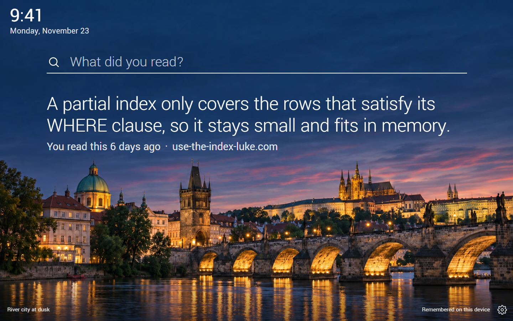
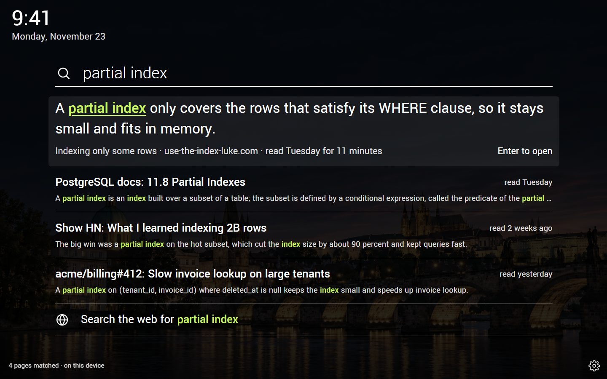
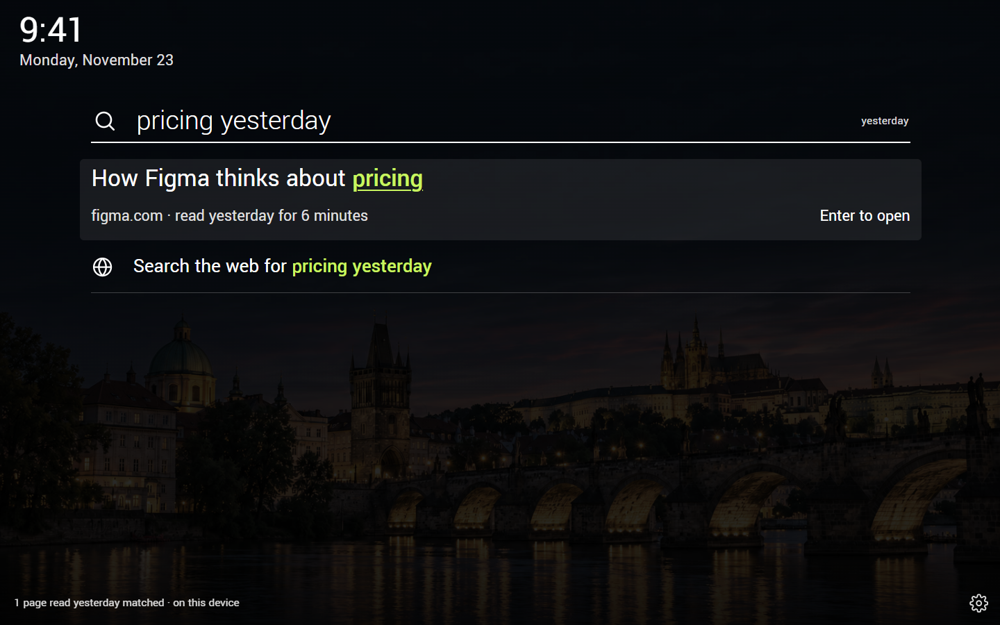
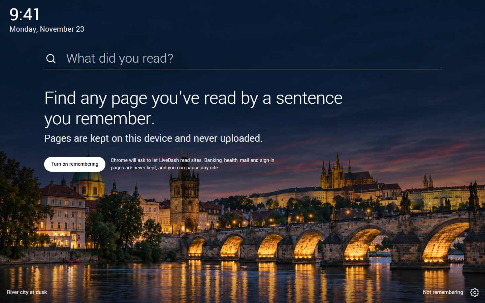
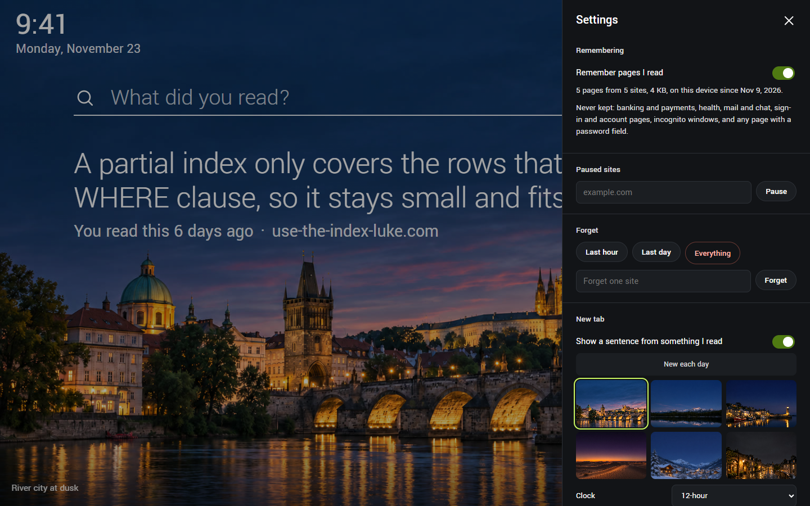

# LiveDash

A Chrome new tab that finds any page you've read by a sentence you remember.

You read something useful last week and can't find it again. The title is forgotten, the history entry says "Untitled", and a web search returns everything except that page. With LiveDash on, you type what you remember, "partial index where clause", and it shows the sentence from the page you read, when you read it, and opens the page scrolled to that sentence. The text of what you read stays on your computer. There is no account, no server and no AI model.

LiveDash is not on the Chrome Web Store yet. [Install it from source](#install).

## What it does

- **Search pages by what they said.** Once a page has been open and visible for about eight seconds, LiveDash keeps its readable text. Results show the best-matching sentence, with your words highlighted, the section it was under, the site, and when and how long you read it.
- **Opens at the sentence.** Enter opens the page with the sentence highlighted (Chrome's text fragments). If the page is already open in a tab, Enter switches to that tab instead.
- **Time phrases.** Add `yesterday`, `this morning`, `last week`, `3 days ago` or `on monday` to search only what you read then. A time phrase on its own lists what you read in that window.
- **A sentence from something you read.** The empty new tab shows one sentence from a page you spent at least a minute on, two days to two months ago, with when and where you read it. You can turn this off.
- **Addresses and the web.** Typing an address offers to go there; the last row searches the web with Chrome's engine or the one you pick.





## Privacy

Remembering is off until you turn it on. Turning it on asks Chrome for access to read `https` sites, the broadest permission an extension can ask for, so here is exactly what it is used for:

- The page text is stored in this browser's extension storage (IndexedDB) and is never sent anywhere. LiveDash makes no network requests of its own.
- Never kept, whatever your settings: incognito windows; banking, payment, crypto, health, insurance and tax sites; webmail, chat and file-storage apps; sign-in, account, checkout and settings pages; and any page showing a password, card number or one-time code field.
- The toolbar button shows what happens to the page in front of you, and pauses that site or forgets that page.
- Settings shows how many pages are kept and how much space they take, pauses any site, and forgets the last hour, the last day, one site or everything.
- Turning remembering off also removes the site access.





Full details are in [PRIVACY.md](PRIVACY.md).

## Install

You need Chrome 120 or newer and Node.js 22.18 or newer.

```bash
git clone https://github.com/Mahan-Imanian/LiveDash.git
cd LiveDash
npm ci
npm run build
```

Open `chrome://extensions`, turn on **Developer mode**, choose **Load unpacked** and select `.output/chrome-mv3`. Open a new tab and press **Turn on remembering**. Pages open in other tabs at that moment are read too.

## Keys

| Action | Key |
| --- | --- |
| Focus the search line | <kbd>/</kbd> |
| Move through results | <kbd>↑</kbd> <kbd>↓</kbd> |
| Open, or switch to the open tab | <kbd>Enter</kbd> |
| Open in a new background tab | <kbd>Ctrl</kbd> <kbd>Enter</kbd> or middle-click |
| Forget the selected page | <kbd>Shift</kbd> <kbd>Delete</kbd> |
| Clear the search | <kbd>Esc</kbd> |
| What happens to this page (toolbar popup) | <kbd>Alt</kbd> <kbd>Shift</kbd> <kbd>L</kbd> |

## How it works

| Part | Files | What it does |
| --- | --- | --- |
| Page reader | `entrypoints/reader.content.ts` | Registered only while remembering is on. Waits until the page has been visible for eight seconds, takes the text of paragraphs, list items, headings and quotes from the article or main content, skips navigation, forms and hidden text, and reports reading time when you leave. |
| Service worker | `entrypoints/background.ts` | Registers or removes the reader as permission and settings change, checks every page against the never-keep rules again, and writes to the index. |
| Index | `src/memory/db.ts` | One IndexedDB database: each page's text, visits and reading time, plus a word-to-pages table. A search intersects the pages holding every word (the last word as a prefix, since you're still typing). |
| Ranking | `src/memory/rank.ts`, `src/memory/text.ts` | Picks the sentence with the most query words, words in order and side by side counting extra, then orders pages by that sentence, the title, how recent the visit was, how often and how long you read. See [docs/ranking.md](docs/ranking.md). |
| Rules | `src/memory/privacy.ts` | The never-keep list, address cleanup and title cleanup. |
| Time phrases | `src/lib/since.ts` | Reads "yesterday", "last week", "3 days ago" and similar at either end of the search. |
| New tab | `src/app/` | The photo, the veil over it, the search line, results, settings and the toolbar popup. |

The six background pictures were generated for this project and ship with the extension. Over each one, LiveDash samples the pixels behind the text and darkens them just enough for white text to reach at least 4.5:1 contrast.

## Known limits

- Only `https` pages are read. Pages that render their text in a canvas or inside cross-origin frames, PDFs and video transcripts are not.
- Pages you read before turning remembering on can't be found.
- Words are split on letters and digits, so Chinese, Japanese and Thai text, which has no spaces, only matches whole runs of characters.
- Time phrases are English only.
- A page is stored again only when its text changes; up to about 120,000 characters of text are kept per page.
- The never-keep list works from the address alone and can't know every bank or clinic. Pause any site it misses from the toolbar button.
- The ranking weights were set by hand and have not been measured against real use.
- Chrome only.

## Development

```bash
npm run dev     # live-reloading build in a Chrome instance
npm run check   # type check, Biome lint and format, unit tests
npm run build   # production build in .output/chrome-mv3
npm run zip     # packed copy in .output/
```

The unit tests run TypeScript directly with `node --test`:

| Test | Covers |
| --- | --- |
| `tests/memory-text.test.ts` | Words, sentences, the best sentence for a query, highlighting, text-fragment links, which sentences can be shown on their own, the never-keep rules, address and title cleanup |
| `tests/memory-rank.test.ts` | Result order and the "read Tuesday for 11 minutes" labels |
| `tests/photos.test.ts` | The veil reaching 4.5:1 and the daily picture rotation |
| `tests/since.test.ts`, `tests/since-dst.test.ts` | Time phrases, including daylight-saving days |

There are no browser tests in CI; the reader, layout and keyboard use are checked by hand. Project layout and ground rules are in [CONTRIBUTING.md](.github/CONTRIBUTING.md).

## License

MIT, see [LICENSE](LICENSE). Bundled third-party licences, including the Yantramanav font (SIL Open Font License), are in [public/THIRD_PARTY_NOTICES.txt](public/THIRD_PARTY_NOTICES.txt).
